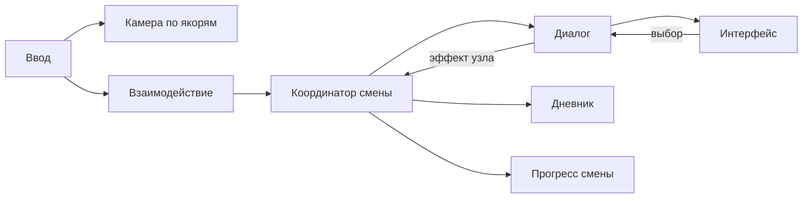

# Архитектура

Статус: основа принята в [ADR-0001](decisions/0001-godot-foundation.md), навигация M1 — в [ADR-0002](decisions/0002-anchor-navigation.md), контент v1 — в [ADR-0003](decisions/0003-dialogue-content.md). Реализованы Main, BarLevel, AnchorPoint, AnchorCamera, InteractionController, NavigationHUD, DialogueCatalog и DialogueContentValidator. Исполнитель диалогов, дневник, смены и сохранения пока запланированы.

## Техническая основа

Godot 4.7.2 Standard, GDScript, текстовые `.tscn`/`.tres`. Проект в корне, без внешних библиотек. Renderer Compatibility выбран для начала и доступного запуска; художественные требования могут потребовать отдельного пересмотра. Целевая ОС предварительно Windows desktop, финальная матрица не утверждена.

Масштаб 3D: одна единица — один метр. Идентификаторы контента стабильные, текстовые `snake_case`, не равны отображаемому имени. Runtime-состояние отделять от данных и визуальных узлов.

## Границы модулей

| Модуль | Ответственность | Не должен делать |
| --- | --- | --- |
| `Main` | Собирает и связывает модули сценой | Хранить все правила игры в одном скрипте |
| `BarLevel` | Геометрия, якоря, освещение, точки взаимодействия | Управлять ветками диалогов |
| `AnchorCamera` | Активный якорь, обзор, допустимый переход | Расходовать время или открывать дневник напрямую |
| `InteractionController` | Выбор доступной цели и запрос действия | Знать внутреннюю структуру каждого гостя |
| `DialogueCatalog` / `DialogueContentValidator` | Валидация комплектов JSON v1, атомарный снимок, разрешение ID | Применять эффекты, хранить прогресс или управлять UI |
| `DialogueRunner` | Загрузка данных, текущий узел, допустимые ответы | Рисовать UI, писать сохранения |
| `Journal` | Набор известных терминов и уведомление об изменении | Самостоятельно менять реплики |
| `ShiftSession` | Режим ввода, прогресс смены, координация эффектов | Зависеть от пути до кнопки UI |
| `HUD` / `DialoguePanel` / `JournalPanel` | Отображение и команды пользователя | Быть единственным хранилищем прогресса |
| `SaveService` (если принят) | Версионированный снимок и восстановление | Сериализовать дерево узлов |

Фактические пути M1: `scenes/main/main.tscn` + `scripts/main/main.gd`; локация `scenes/levels/bar_graybox.tscn`; камера `scenes/player/anchor_camera.tscn` + `scripts/player/anchor_camera.gd`; якорь `scenes/navigation/anchor_point.tscn` + `scripts/navigation/anchor_point.gd`; взаимодействие `scripts/interaction/`; интерфейс `scenes/ui/` + `scripts/ui/navigation_hud.gd`.

Main настраивает камеру и связывает сигналы. AnchorPoint сообщает о запросе, Main передаёт его AnchorCamera. NavigationHUD сообщает о выборе ID, Main использует тот же Interactable3D через InteractionController. Коллизии геометрии — слой 1, цели — слой 2. Инструкция по изменению сцены — M1_NAVIGATION.

Папки модулей создавать вместе с реализацией, не генерировать десятки пустых классов заранее. Нет autoload-синглтонов до появления реальной необходимости в межсценовом времени жизни. Общение по явным ссылкам и сигналам. Глобальная шина событий сейчас не нужна.

## Предлагаемый поток

Координатор применяет эффекты завершённых событий один раз и связывает ввод. Модули не ищут друг друга по цепочкам `get_parent().get_parent()` и не зависят от текста UI.

## Ввод

В M1 действуют exploration, transition и menu. Main владеет состоянием меню; AnchorCamera — состоянием перехода. При переходе второй запрос запрещён, камера меняет позу под полным затемнением. Меню блокирует новые команды и обзор; текущий fade штатно заканчивается. Это не глобальная пауза SceneTree, будущие системы времени потребуют координации.

InputMap задан в `project.godot`: `look` (ПКМ), `look_left/right/up/down` (стрелки), `reset_look` (R), `interact` (E), `anchor_1…4` (цифры основного ряда), `toggle_menu` (Escape). Удержание ПКМ захватывает мышь; отпускание, переход, меню и потеря фокуса освобождают её. Вертикальный обзор ограничен ±65°.

Будущие режимы dialogue, journal, shift_complete пока не реализованы. При открытии дневника из диалога нужно будет сохранять режим возврата и блокировать те же точки входа. ShiftSession должен перенять координацию Main, когда появится соответствующая задача.

## Данные и расширение

Сцены — размещение и внешний вид; диалоги/словарь — JSON v1 в `content/dialogues/` и `content/glossary/`. Код каталога и валидатора — `scripts/dialogue/`. Описание схемы и инструкции автора — DIALOGUE_CONTENT. Никаких новых плагинов и зависимостей.

DialogueCatalog (RefCounted) владеет только принятым снимком. Валидация всего комплекта предшествует подмене; ошибки не раскрывают частично загруженные данные. Геттеры возвращают копии. Текущая реплика и изученные термины будут жить в DialogueRunner/Journal, а не в исходных JSON. Контент пока не подключён к Main: DA-020 не меняет поведение бара.

Примеры тестового контента должны быть помечены TEST. Постоянные ID сохранять при изменении текста. Эффекты узлов должны иметь стабильный ключ, чтобы повторная отрисовка не повторяла награду и расход времени.

Перед реализацией новых систем принять конкретные сигнатуры из CONTRACTS. Архитектурные изменения объяснять в ADR и сразу обновлять этот документ.
