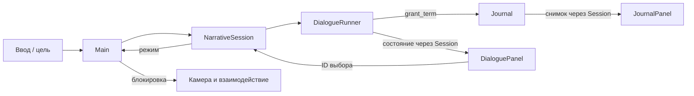

# Архитектура

Статус: M1 и DA-020–DA-021 слиты владельцем. DA-022 добавляет GuestService, ServiceGuest, ServicePanel и связь с NarrativeSession. Основа — ADR-0001, навигация — ADR-0002, JSON — ADR-0003, исполнение — ADR-0004, обслуживание — [ADR-0005](decisions/0005-guest-service.md). Время, конец смены и сохранения ещё не реализованы. Художественная цель — VISUAL_DIRECTION.

## Техническая основа

Godot 4.7.2 Standard, GDScript, текстовые `.tscn`/`.tres`. Проект в корне, без внешних библиотек. Renderer Compatibility выбран для начала и доступного запуска; художественные требования могут потребовать отдельного пересмотра. Целевая ОС предварительно Windows desktop, финальная матрица не утверждена.

Масштаб 3D: одна единица — один метр. Идентификаторы контента стабильные, текстовые `snake_case`, не равны отображаемому имени. Runtime-состояние отделять от данных и визуальных узлов.

## Границы модулей

| Модуль | Ответственность | Не должен делать |
| --- | --- | --- |
| `Main` | Собирает и связывает модули сценой | Хранить все правила игры в одном скрипте |
| `BarLevel` | Геометрия, якоря, освещение, точки взаимодействия | Управлять ветками диалогов |
| `AnchorCamera` | Активный якорь, обзор, допустимый переход | Расходовать время или открывать дневник напрямую |
| `InteractionController` | Выбор доступной цели и запрос действия | Знать внутреннюю структуру каждого гостя |
| `DialogueCatalog` / `DialogueContentValidator` | Валидация комплектов JSON v1, атомарный снимок, разрешение ID | Применять эффекты, хранить прогресс или управлять UI |
| `DialogueRunner` | Снимок определений, текущий узел, допустимые ответы, одноразовый grant_term | Рисовать UI, читать файлы, писать сохранения |
| `Journal` | Набор известных терминов и уведомление об изменении | Самостоятельно менять реплики |
| `NarrativeSession` | Режимы экранов, модели Runner/Journal, безопасные команды UI | Управлять камерой напрямую или начислять время |
| `GuestService` | Проверенное меню, выбранный напиток и одноразовая подача | Знать о мешах, UI, деньгах или времени |
| `ServiceGuest` | Общая цель разговора и видимый результат подачи | Хранить заказ вместо модели |
| `ShiftSession` (план) | Прогресс смены и эффекты завершённых событий | Зависеть от пути до кнопки UI |
| `HUD` / `DialoguePanel` / `JournalPanel` | Отображение и команды пользователя | Быть единственным хранилищем прогресса |
| `SaveService` (если принят) | Версионированный снимок и восстановление | Сериализовать дерево узлов |

Фактические пути M1: `scenes/main/main.tscn` + `scripts/main/main.gd`; локация `scenes/levels/bar_graybox.tscn`; камера `scenes/player/anchor_camera.tscn` + `scripts/player/anchor_camera.gd`; якорь `scenes/navigation/anchor_point.tscn` + `scripts/navigation/anchor_point.gd`; взаимодействие `scripts/interaction/`; интерфейс `scenes/ui/` + `scripts/ui/navigation_hud.gd`.

Main настраивает камеру и связывает сигналы. AnchorPoint сообщает о запросе, Main передаёт его AnchorCamera. NavigationHUD сообщает о выборе ID, Main использует тот же Interactable3D через InteractionController. Коллизии геометрии — слой 1, цели — слой 2. Инструкция по изменению сцены — M1_NAVIGATION.

Папки модулей создавать вместе с реализацией, не генерировать десятки пустых классов заранее. Нет autoload-синглтонов до появления реальной необходимости в межсценовом времени жизни. Общение по явным ссылкам и сигналам. Глобальная шина событий сейчас не нужна.

## Реализованный поток DA-021

Runner применяет grant_term при входе в узел один раз за сессию; NarrativeSession управляет экранами, Main — доступностью мира. Будущий ShiftSession сможет слушать события завершения, но его пока нет. Повторный разговор разрешён, поэтому dialogue_id не является уникальным ID события прохождения: для времени потребуется отдельный ключ выполнения. Модули не ищут друг друга по цепочкам родителей и не зависят от текста UI.

## Ввод

NarrativeSession владеет exploration, dialogue, journal, menu, service, а AnchorCamera — переходом. Main блокирует мир во всех модальных режимах. Во время fade дневник, разговор и обслуживание не открываются, меню допустимо. Fade заканчивается штатно и не снимает блокировку. Это не глобальная пауза SceneTree.

InputMap: look (ПКМ), look_left/right/up/down (стрелки), reset_look (R), interact (E), anchor_1…4, toggle_menu (Escape), toggle_journal (J), talk (T), serve (B). Удержание ПКМ захватывает мышь; отпускание, переход, модальный экран и потеря фокуса освобождают её. Вертикаль ±65°. Физические буквы не зависят от русской раскладки. Tab/Enter обрабатываются UI Godot.

Journal хранит режим возврата exploration/dialogue; меню — любой предыдущий режим, включая journal поверх dialogue. Escape закрывает журнал, но из разговора открывает меню. Прерывание разговора — явная кнопка. Подробности — DIALOGUE_RUNTIME. shift_complete ещё не реализован.

## Данные и расширение

Сцены — размещение и внешний вид; диалоги/словарь — JSON v1 в `content/dialogues/` и `content/glossary/`. Код каталога и валидатора — `scripts/dialogue/`. Описание схемы и инструкции автора — DIALOGUE_CONTENT. Никаких новых плагинов и зависимостей.

DialogueCatalog владеет принятым снимком. Main читает экспортированные glossary_path и dialogue_paths, проверяет загрузку и настраивает NarrativeSession. Runner и Journal (RefCounted) копируют определения один раз; текущая реплика и изученные термины живут в моделях, исходные JSON не меняются. UI получает копии. Сохранений и горячего изменения сессии нет; новая игра создаёт новые модели.

Файлы исполнения: `scripts/dialogue/dialogue_runner.gd`, `scripts/journal/journal.gd`, `scripts/session/narrative_session.gd`, две панели и их скрипты. В DA-022 Main использует `scenes/characters/test_guest.tscn` вместо сферы: ServiceGuest наследует DialogueTrigger, прежнее имя узла сохранено. Модель — `scripts/service/guest_service.gd`, меню — `scenes/ui/service_panel.tscn`. Настройки двух напитков пока экспортируются в Main, отдельно от JSON v1. Сервис и разговор не меняют состояние друг друга скрытым образом.

Примеры тестового контента должны быть помечены TEST. Постоянные ID сохранять при изменении текста. Эффекты узлов должны иметь стабильный ключ, чтобы повторная отрисовка не повторяла награду и расход времени.

Перед реализацией новых систем принять конкретные сигнатуры из CONTRACTS. Архитектурные изменения объяснять в ADR и сразу обновлять этот документ.
