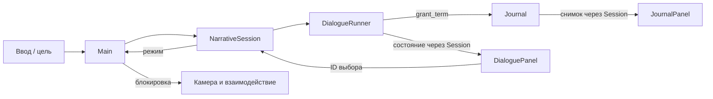

# Архитектура

CHAR-01: отдельная scenes/characters/visitor_model.tscn строит TEST-геометрию/15-костный Skeleton3D через visitor_model.gd. GuestArt переключает весь видимый Body между D и прежними A/B/C, подписывается на Session.mode_changed только для амплитуды жеста. Коллизии и игровые модели не принадлежат этому арту. [Описание и ограничения](CHARACTER_PROTOTYPE.md).

DA-063: текущий бар использует ServicePanel/DrinkWorkbench с тремя DrinkPreparation (подача, смесительный стакан, шейкер), DrinkBottleStock и DrinkSpillSurface; NarrativeSession сохраняет речь в SERVICE. GuestService запечатывает фактический состав и испускает прежнее одноразовое событие смены. Подробные API/потребители — [контракт бара](parallel/bar/CONTRACTS.md), решения/исследование — parallel/bar. Новый дом и Journal annotations коллеги сохранены; общий default-цикл проверяет release_integration_test. [ADR-0026](decisions/0026-bar-home-journal-integration.md).

Интеграция 2026-10-27: main включает DA-062/HOME-02/JOURNAL-02. Дом создаёт отдельный HouseInterior с геометрией/локальными бытовыми действиями, не меняя бар/формат домашнего прогресса. Книга рисует текст через TextParagraph, Journal хранит символьные диапазоны пометок отдельно от представления и передаёт их существующему checkpoint. Контракты — parallel/home/CONTRACTS и parallel/journal/CONTRACTS; проверки подключены к общему runner. Новый EXE этим слиянием не выпускается.

DA-058: InteractionController связывает физическую поверхность с Interactable3D через register_surface и берёт ближайшее попадание, обновляя его при E. Main создаёт логический WorkstationTarget, NPC доступен рядом без рабочего якоря. При ходьбе ray из камеры, у стойки от курсора; legacy графы прежние. WORLD_INTERACTION/ADR-0024.

DA-053: Main использует наследуемую сцену DialogueBubblePanel, явно связывает текущего NPC с камерой; Runner/Session прежние. При DIALOGUE разрешён обзор на месте через set_dialogue_look, тело/выход с места заблокированы. Подробности — DIALOGUE_BUBBLES/ADR-0021; старое описание полностью неподвижной камеры в диалоге относится к прежнему UI.

DA-052: текущая навигация — свободная ходьба и локальные рабочие места, [FREE_ROAM](FREE_ROAM.md)/ADR-0020. Описание графа M1 ниже — исторический контракт и база прежних тестов. Main/Home используют FreeRoamCamera; модели смены и checkpoint v1 не меняются.

DA-051: описанные ниже DA-047–DA-050 объединены в main по поручению пользователя после проверки чистого коммита 04c0c96. Исторические ссылки на feat/game-improvements обозначают источник изменений, не отдельную обязательную ветку для запуска. Локальное форматирование project.godot в main не включено, нового экспорта пока нет.

DA-049: Main динамически создаёт отдельный HomeExploration из scenes/home/; черновая комната изолирована от коллизий бара техническим offset 32 м. В HOME собственные AnchorCamera/InteractionController/HomeHUD, камера применяется и в фоне книги/меню. NarrativeSession по-прежнему владеет режимами/маршрутом; optional configure_commute(...,true) отключает старый плоский HOME. HomeState отделяет наблюдения/события от Journal, передаётся вместе с ним через обычную новую смену. HomeObject использует прежний Interactable3D, HomeExploration координирует локальный осмотр и сигналы команд сессии. Контракты — CONTRACTS/ADR-0018, расширение — HOME.md.

DA-048 в feat/game-improvements: EnvironmentAudio — самостоятельная 3D-сцена внутри Presentation, содержит только новые пространственные звуки улицы/мебели и их расписание. Прежний гул DA-047 сохранён. PresentationController передаёт общий gain/контекст, Main связывает режим с окружением и AnchorCamera с настройками HUD. Камера хранит только предпочтения скорости/fade в памяти процесса; модели прогресса и граф якорей прежние. Контракты/решение — CONTRACTS и ADR-0017.

Статус: все готовые изменения M1 и DA-020–DA-037 объединены в main по поручению владельца (DA-003). DA-022 добавляет обслуживание, DA-023 — ShiftClock, итоги и новую смену. Основа — ADR-0001, навигация — ADR-0002, JSON — ADR-0003, исполнение — ADR-0004, обслуживание — [ADR-0005](decisions/0005-guest-service.md), смена — [ADR-0006](decisions/0006-shift-and-bartender.md). Сохранений пока нет. Художественная цель — VISUAL_DIRECTION.

## Техническая основа

Godot 4.7.2 Standard, GDScript, текстовые `.tscn`/`.tres`. Проект в корне, без внешних библиотек. Renderer Compatibility выбран для начала и доступного запуска; художественные требования могут потребовать отдельного пересмотра. Целевая ОС предварительно Windows desktop, финальная матрица не утверждена.

Масштаб 3D: одна единица — один метр. Идентификаторы контента стабильные, текстовые `snake_case`, не равны отображаемому имени. Runtime-состояние отделять от данных и визуальных узлов.

## Границы модулей

| Модуль | Ответственность | Не должен делать |
| --- | --- | --- |
| `Main` | Собирает и связывает модули сценой | Хранить все правила игры в одном скрипте |
| `BarLevel` | Геометрия, якоря, освещение, точки взаимодействия | Управлять ветками диалогов |
| `AnchorCamera` | Активный якорь, обзор, допустимый переход | Расходовать время или открывать дневник напрямую |
| `InteractionController` | Выбор доступной цели и запрос действия | Знать внутреннюю структуру каждого гостя |
| `DialogueCatalog` / `DialogueContentValidator` | Валидация комплектов JSON v1, атомарный снимок, разрешение ID | Применять эффекты, хранить прогресс или управлять UI |
| `DialogueRunner` | Снимок определений, текущий узел, допустимые ответы, одноразовый grant_term | Рисовать UI, читать файлы, писать сохранения |
| `Journal` | Набор известных терминов и уведомление об изменении | Самостоятельно менять реплики |
| `NarrativeSession` | Режимы экранов, модели, передача завершённых событий часам, безопасные команды UI | Управлять камерой напрямую или хранить арифметику времени |
| `GuestService` | Проверенное меню, выбранный напиток и одноразовая подача | Знать о мешах, UI, деньгах или времени |
| `ServiceGuest` | Общая цель разговора и видимый результат подачи | Хранить заказ вместо модели |
| `ShiftClock` | Бюджет, уникальные завершённые события и единственный конец | Знать о сценах, UI или сюжетных репликах |
| `HUD` / `DialoguePanel` / `JournalPanel` | Отображение и команды пользователя | Быть единственным хранилищем прогресса |
| `SaveService` (если принят) | Версионированный снимок и восстановление | Сериализовать дерево узлов |

Фактические пути M1: `scenes/main/main.tscn` + `scripts/main/main.gd`; локация `scenes/levels/bar_graybox.tscn`; камера `scenes/player/anchor_camera.tscn` + `scripts/player/anchor_camera.gd`; якорь `scenes/navigation/anchor_point.tscn` + `scripts/navigation/anchor_point.gd`; взаимодействие `scripts/interaction/`; интерфейс `scenes/ui/` + `scripts/ui/navigation_hud.gd`.

Main настраивает камеру и связывает сигналы. AnchorPoint сообщает о запросе, Main передаёт его AnchorCamera. NavigationHUD сообщает о выборе ID, Main использует тот же Interactable3D через InteractionController. Коллизии геометрии — слой 1, цели — слой 2. Инструкция по изменению сцены — M1_NAVIGATION.

Папки модулей создавать вместе с реализацией, не генерировать десятки пустых классов заранее. Нет autoload-синглтонов до появления реальной необходимости в межсценовом времени жизни. Общение по явным ссылкам и сигналам. Глобальная шина событий сейчас не нужна.

## Реализованный поток DA-021

Runner применяет grant_term при входе в узел один раз за сессию; NarrativeSession управляет экранами и передаёт завершения в ShiftClock, Main — доступностью мира. Повторный разговор разрешён: уникальный ключ `dialogue:<id>:<serial>` обозначает отдельное прохождение. Подача использует ключ GuestService. Модули не ищут друг друга по цепочкам родителей и не зависят от текста UI.

## Ввод

DA-035 (TEST-проход): Body/TestFace — независимая сцена анатомии, GuestArt связывает три нейтральных appearance_id с меню сравнения. Лицо не хранит диалог/заказ и не имеет коллизии. Все варианты используют прежний ServiceGuest/guest_id. Глобальное TEST-предпочтение не является моделью будущего состава NPC; после Q-04 нужна отдельная привязка персонажа/портрета. TEST_FACES и ADR-0014 фиксируют частичную готовность задачи.

DA-042: детализация ретро-эффекта привязана к физическим пикселям через SCREEN_PIXEL_SIZE, а не логическим 720 строкам UI. PresentationController владеет adaptive/native/classic и связывает `%ImageDetail`; шрифты MSDF для default и книги. Нет нового игрового состояния/зависимости Session. IMAGE_DETAIL и ADR-0013 описывают проверку реальных пикселей.

DA-037 добавляет отдельный DisplaySettings в Main для окна/монитора и F11. Контроллер связывает настройки HUD, использует Window/DisplayServer, не знает о Session. UI — canvas_items/expand от 1280×720; меню имеет отдельную прокрутку настроек при постоянных кнопках продолжения/выхода. DISPLAY/ADR-0012 описывают границы; fullscreen проверяется графически отдельно от headless. F11 доступен также во время набора поиска дневника.

DA-031 добавляет режимы travel/home. NarrativeSession связывает CommuteFlow и CommutePanel; Main перезагружает законченную текущую сцену по new_shift_requested после обратного пути. Меню приостанавливает Tween маршрута, дневник дома возвращает home. Дома во время чтения остаётся только фон маршрута на слое 11 ниже JournalPanel; его кнопки скрыты и не забирают фокус. Команды мира по-прежнему доступны только в exploration. Подробности — COMMUTE_FLOW и ADR-0009.

NarrativeSession владеет exploration, dialogue, journal, menu, service и shift_complete, а AnchorCamera — переходом. Он связывает завершённые действия со ShiftClock; Main блокирует мир во всех модальных режимах. Во время fade новые действия не открываются, меню допустимо. В конце дневник/меню возвращают к итогам, не в мир. Новый цикл — перезагрузка Main и создание новых моделей.

InputMap: look (ПКМ), look_left/right/up/down (стрелки), reset_look (R), interact (E), anchor_1…4, toggle_menu (Escape), toggle_journal (J), talk (T), serve (B). Удержание ПКМ захватывает мышь; отпускание, переход, модальный экран и потеря фокуса освобождают её. Вертикаль ±65°. Физические буквы не зависят от русской раскладки. Tab/Enter обрабатываются UI Godot.

Journal хранит режим возврата exploration/dialogue/shift_complete; меню — предыдущий режим, включая journal поверх dialogue. Escape закрывает журнал, но из разговора открывает меню. Прерывание разговора — явная кнопка. Подробности — DIALOGUE_RUNTIME и SHIFT_FLOW.

## Данные и расширение

DA-033 делает Journal прогрессом нескольких смен в памяти: определения отделены от метаданных записей, read/bookmarked/selected_term_id хранятся в модели, поиск/индекс — в UI. Runner передаёт источник узла/смены; Session принимает явные команды чтения/закладки. При обычной новой смене Main передаёт тот же Journal через одноразовую мета-запись SceneTree, привязанную к scene_file_path; новый Main её проверяет/потребляет. Часы/заказ/Runner обновляются, прямой тестовый reset очищает всё. Нет autoload и дискового save. JOURNAL_CORE и ADR-0010 описывают владение/совместимость; DA-034 меняет только представление книги на этой основе.

DA-030 отделяет представление от механик: BarLevel/Art применяет материалы/свет и добавляет декор без коллизий, Body TEST-гостя меняет только внешность, отдельный PresentationController владеет эффектом/фоновым звуком и пользовательскими предпочтениями. CanvasLayer 2 располагается ниже интерфейса и fade. Main связывает контроллер с настройками NavigationHUD. Подробности — ART_GUIDE и ADR-0008. Static-поля содержат только предпочтения; часы, журнал, заказ и прочий игровой прогресс не перенесены в них.

Экспорт DA-024 — [BUILD](BUILD.md), решение ADR-0007. Текстовые сцены остаются текстовыми в PCK для сохранения связей якорей; JSON включается явно. Только проверочный пресет integration_test выбирает отдельную тестовую стартовую сцену; игровой Main не содержит тестового режима.

Сцены — размещение и внешний вид; диалоги/словарь — JSON v1 в `content/dialogues/` и `content/glossary/`. Код каталога и валидатора — `scripts/dialogue/`. Описание схемы и инструкции автора — DIALOGUE_CONTENT. Никаких новых плагинов и зависимостей.

DialogueCatalog владеет принятым снимком. Main читает экспортированные glossary_path и dialogue_paths, проверяет загрузку и настраивает NarrativeSession. Runner и Journal (RefCounted) копируют определения один раз; текущая реплика и изученные термины живут в моделях, исходные JSON не меняются. UI получает копии. Сохранений и горячего изменения сессии нет; новая игра создаёт новые модели.

Файлы исполнения: `scripts/dialogue/dialogue_runner.gd`, `scripts/journal/journal.gd`, `scripts/session/narrative_session.gd`, две панели и их скрипты. В DA-022 Main использует `scenes/characters/test_guest.tscn` вместо сферы: ServiceGuest наследует DialogueTrigger, прежнее имя узла сохранено. Модель — `scripts/service/guest_service.gd`, меню — `scenes/ui/service_panel.tscn`. Настройки двух напитков пока экспортируются в Main, отдельно от JSON v1. Сервис и разговор не меняют состояние друг друга скрытым образом.

Примеры тестового контента должны быть помечены TEST. Постоянные ID сохранять при изменении текста. Эффекты узлов должны иметь стабильный ключ, чтобы повторная отрисовка не повторяла награду и расход времени.

Перед реализацией новых систем принять конкретные сигнатуры из CONTRACTS. Архитектурные изменения объяснять в ADR и сразу обновлять этот документ.

Модель DA-033 и книга DA-034 реализованы. BookPaginator отделён от Journal, BookArt рисует оформление, JournalPanel управляет переходами и отправляет команды через Session. Прогресс чтения хранится смещением символов в Journal, анимации/номера страниц — только в UI. Пользовательское закрытие асинхронно, прежнее принудительное close_journal синхронно. JOURNAL_BOOK и ADR-0011 описывают поведение, CONTRACTS — API. Досье/связи/противоречия остаются предложением до Q-09.

## Сохранения DA-032

CheckpointCodec сериализует только независимые модели прогресса, CheckpointStore отвечает за user:// и резервную копию. Main — единственная точка загрузки/записи на границе смены, UI показывает результат и запрашивает подтверждённый новый старт. Session/Runner не занимаются файловой системой. [SAVES](SAVES.md), [ADR-0019](decisions/0019-shift-checkpoint.md).

DA-054: SpeechPaginator измеряет normal/bold через TextParagraph и делит plain-диапазоны для отображения. DialogueText.styled_slice сохраняет выделение на границах; literal-флаг сохраняет непарные ** буквально. DialogueBubblePanel хранит номер текущего продолжения, Runner/Journal не изменяются при переходе пузырька.

DA-057: PreferenceStore/PreferenceController отделяют параметры восприятия от checkpoint. Main создаёт контроллер и связывает Presentation/AnchorCamera/JournalPanel/DisplaySettings через preferences_changed. Загрузка только при старте, RUN_HANDOFF переносит enabled/store, перезагрузка не применяет окно повторно. Прогресс и JSON checkpoint v1 прежние. PLAYER_SETTINGS/ADR-0023.

## DA-059: задняя стойка и движение в разговоре

[ADR-0025](decisions/0025-backbar-walking-dialogue.md) заменяет прежнюю блокировку тела DIALOGUE и привязку переднего прилавка. Публичные методы не менялись; меняется поведенческий контракт Main в free_roam_enabled=true: controls_enabled в exploration/dialogue, взаимодействия мира пока только exploration. При входе в dialogue из focus Main вызывает leave_focus, освобождая тело и возвращая прежний взгляд. Menu/Journal по-прежнему блокируют движение; при возврате к dialogue ходьба возобновляется. Speech/Runner/страница/эффекты не перезапускаются из-за движения, конец не телепортирует игрока.

Main добавляет независимую scenes/levels/back_counter.tscn и AnchorPoint back_counter по дочернему WorkPosition перед configure камеры. Только back_counter в focus_anchor_ids текущего бара. Физические привязки: BackCounter/{Top,Cabinet}/Body и BarLevel/Geometry/{ShelfBack,ShelfUpper,ShelfLower}/Body. CounterTop/Base/Trim не интерактивны. Отсутствие обязательного Body — ошибка настройки. Старый counter/граф и legacy fixtures остаются прежними; Home не меняется.

Потребители: Main, NavigationHUD, back_counter.tscn, world_target_test/free_roam_test/dialogue_bubble_test; check.ps1/Windows Validation уже включают их. Session/Runner/GuestService, сохранения и настройки прежние. Программные service API и UI пока разрешают подачу только exploration у back_counter (legacy: required_anchor). Готовить параллельно разговору будет DA-060 с отдельным решением, сейчас не обещать такую возможность.
