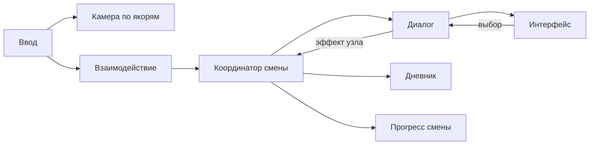

# Архитектура

Статус: основа принята в [ADR-0001](decisions/0001-godot-foundation.md); игровые модули ниже **запланированы, не реализованы**. Реальный код сейчас — стартовая сцена и smoke-проверка.

## Техническая основа

Godot 4.7.2 Standard, GDScript, текстовые `.tscn`/`.tres`. Проект в корне, без внешних библиотек. Renderer Compatibility выбран для начала и доступного запуска; художественные требования могут потребовать отдельного пересмотра. Целевая ОС предварительно Windows desktop, финальная матрица не утверждена.

Масштаб 3D: одна единица — один метр. Идентификаторы контента стабильные, текстовые `snake_case`, не равны отображаемому имени. Runtime-состояние отделять от данных и визуальных узлов.

## Границы будущих модулей

| Модуль | Ответственность | Не должен делать |
| --- | --- | --- |
| `Main` | Собирает и связывает модули сценой | Хранить все правила игры в одном скрипте |
| `BarLevel` | Геометрия, якоря, освещение, точки взаимодействия | Управлять ветками диалогов |
| `AnchorCamera` | Активный якорь, обзор, допустимый переход | Расходовать время или открывать дневник напрямую |
| `InteractionController` | Выбор доступной цели и запрос действия | Знать внутреннюю структуру каждого гостя |
| `DialogueRunner` | Загрузка данных, текущий узел, допустимые ответы | Рисовать UI, писать сохранения |
| `Journal` | Набор известных терминов и уведомление об изменении | Самостоятельно менять реплики |
| `ShiftSession` | Режим ввода, прогресс смены, координация эффектов | Зависеть от пути до кнопки UI |
| `HUD` / `DialoguePanel` / `JournalPanel` | Отображение и команды пользователя | Быть единственным хранилищем прогресса |
| `SaveService` (если принят) | Версионированный снимок и восстановление | Сериализовать дерево узлов |

Папки модулей создавать вместе с реализацией, не генерировать десятки пустых классов заранее. Нет autoload-синглтонов до появления реальной необходимости в межсценовом времени жизни. Общение по явным ссылкам и сигналам. Глобальная шина событий сейчас не нужна.

## Предлагаемый поток

Координатор применяет эффекты завершённых событий один раз и связывает ввод. Модули не ищут друг друга по цепочкам `get_parent().get_parent()` и не зависят от текста UI.

## Ввод

Предлагаемые режимы: `exploration`, `transition`, `dialogue`, `journal`, `shift_complete`. При переходе между якорями второй переход запрещён. Диалог и дневник блокируют игровые действия. При открытии дневника из диалога нужно помнить, к какому режиму возвращаться. Конкретные InputMap-действия и клавиши принимаются в DA-010; в текущем проекте игровые действия ещё не назначены.

## Данные и расширение

Сцены — размещение и внешний вид; диалоги/словарь — отдельные данные `content/`. Выбор JSON или типизированных Resource принять в DA-020 по удобству сценариста и проверяемости. Версионировать формат с первой реализацией. Не добавлять сторонний диалоговый плагин без решения о зависимости.

Примеры тестового контента должны быть помечены TEST. Постоянные ID сохранять при изменении текста. Эффекты узлов должны иметь стабильный ключ, чтобы повторная отрисовка не повторяла награду и расход времени.

Перед реализацией новых систем принять конкретные сигнатуры из CONTRACTS. Архитектурные изменения объяснять в ADR и сразу обновлять этот документ.
