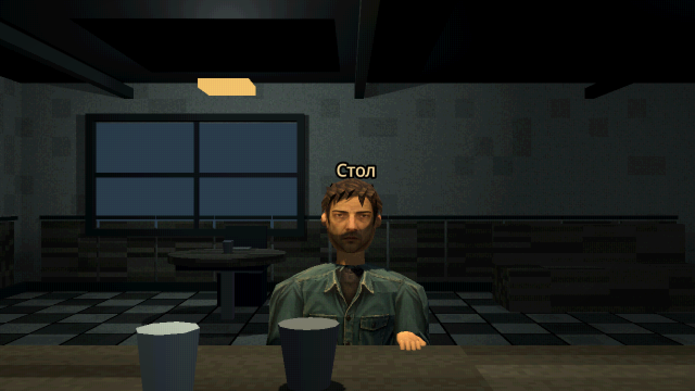

# Текстурированный TEST-посетитель: CHAR-01–03

Актуальная итерация — **CHAR-03**, прямое применение [сохранённого референса](CHARACTER_REFERENCE.md): более широкая/короткая голова, короткая видимая шея, выраженные плечи/талия, асимметричные руки и 9 объёмных прядей. Новые V3 атласы согласуют рисованную детализацию лица/волос/ткани. [Протокол](worklog/2026-10-28-04-reference-model-pass.md). Выбор D/API/15 костей/3 поверхности прежние.

Владелец: второй участник + Codex. Ветка `codex/test-visitor-model`. CHAR-01 (b8b138f) — первый макет. CHAR-02 — художественная доводка по прямому поручению 2026-10-28 после сравнения с Mouthwashing. Только тестовый облик: без имени, биографии и нового guest_id. Новые персонажи/сюжет Q-04 не утверждены.

## Запуск и сравнение

F5 из исходников этой ветки: D выбран по умолчанию. Escape → настройки → «[TEST] Лицо гостя» → **D · Текстурированный посетитель**. A/B/C возвращают прежние голову и тело. Выбор переживает замену сцены в текущем процессе, отдельно на диск не записывается.

`scenes/characters/visitor_model.tscn` создаёт геометрию при запуске через `scripts/characters/visitor_model.gd`. Пустой корень в редакторе до F6 ожидаем. +Z — лицо; подошвы около -1.65 м, верх головы около +0.10 м. GuestArt поворачивает модель +90° Y, сохраняя прежнее направление гостя +X. Отдельно без стойки поднятые руки — та же поза опоры на прилавок, не нейтральная поза для ходьбы.

## Текущая реализация CHAR-03



[Боковой ракурс](art/char03-side.png), [форма без текстур](art/char03-clay.png). Изображения сняты в Godot; это не генеративные концепты.

- Один CharacterMesh/ArrayMesh с тремя поверхностями Skin/Clothing/Leather, 15-костным Skeleton3D и Skin с обратными rest-матрицами. Кожа/одежда не состоят из отдельных жёстких примитивов. Локти, колени и талия имеют смешанные веса.
- Замкнутый череп с объёмом носа/губ/глазниц, отдельной геометрией ушей и общей UV-оболочкой. Затылок не повторяет лицо и не имеет однотонной вставки прежней маски.
- Покатые плечи, тонкий воротник, цельные изогнутые рукава, текстурные карманы/швы/складки. Обувь получила собственную процедурную UV-фактуру подошвы/потёртостей/шнуровки.
- Неодинаковое положение рук, небольшой перенос веса и наклон груди; слабое дыхание/поворот головы. Жест правой руки усиливается плавно в DIALOGUE и затухает при выходе.
- Моргание: два совпадающих UV-кадра, закрытие 0.13 с каждые 4.8 с. Прямоугольных накладок век нет. При скрытии/паузе фаза заморожена.
- 2637 вершин после индексации, 398 вершин со смешанными влияниями; extra_cull_margin 0.15 м для небольших движений. Числа относятся к текущей геометрии, тест проверяет пределы/корректность, а не точный бюджет.

Это законченная итерация улучшения, **не обещание точного совпадения с Mouthwashing или финального художественного качества**. Остаются упрощённые уши/кисти, текстурная анимация вместо объёмных век, фиксированная поза для текущей стойки. Нет липсинка, IK под разные стойки, ходьбы и захвата стакана. DA-035 целиком не закрыта; финальный облик других NPC из этого макета не выводится.

## Текстуры и происхождение

`assets/characters/test_visitor/head_wrap_v3.png` — непрерывная UV головы; `head_blink_v3.png` — тот же атлас с закрытыми глазами; `clothing_atlas_v3.png` — четыре четверти: перед/спина куртки, рукав, брюки. Встроенный imagegen, редактирование собственных V2 в более рисованный стиль, полный prompt и источник в [PROMPT_V3](../assets/characters/test_visitor/PROMPT_V3.md). PNG сохранены без редактирования; import-limit 512, mipmaps, nearest. Одна четверть одежды получает 256×256. Нужны все три .png.import рядом с исходниками. V2 оставлены как история.

Прежний face.png/PROMPT.md сохранён как источник идентичности/история CHAR-01 и больше не используется моделью. Внешних моделей/изображений Mouthwashing в ассетах нет. Геометрия и фактура обуви — собственный код Godot, новых программ/зависимостей нет.

## Контракт и потребители

GuestArt сохраняет configure_controls(hud), set_test_appearance(id)->bool, get_test_appearance()->StringName. ID `test_visitor` соответствует D; неизвестный ID возвращает false без изменения. TestFace.get_appearance_ids() возвращает только A/B/C и прежнюю анатомию. GuestArt подписан на NarrativeSession.mode_changed для talking; коллизии, позиция ServiceGuest, речь, подача, время и сохранения не изменены.

VisitorModel: `skeleton: Skeleton3D`, `talking: bool`; новое диагностическое `is_blinking: bool` читают тест/съёмка. Внутреннее дерево CHAR-01 (BoneAttachment3D/отдельные детали) заменено CharacterMesh; Main/GuestArt внутрь модели не обращаются. Обновлены потребители: visitor_model_test и capture_visitor. Общие .tscn гостя/главной сцены не редактировались.

## Воспроизведение и передача

```powershell
godot --headless --path . res://tests/visitor_model_test.tscn
godot --path . res://tests/visitor_model_test.tscn
godot --path . --script res://tools/capture_visitor.gd
```

Тест включён в check.ps1. Проверяются видимость D/A/B/C, корректные UV/нормали/веса/binds, мягкие переходы, предел вершин, пауза/скрытие/моргание, сохранность разговора/подачи/коллизий и замена сцены.

GPU-тест пишет artifacts/visitor/bar.png (обычный вид) и bar_close.png (тот же ракурс, проверочный zoom FOV 35). Zoom служит осмотру модели и не меняет настройки реальной игры. Capture-скрипт пишет studio_0/65/150.png, face.png/face_blink.png и test_visitor.glb; в headless только экспорт без снимков. Пол/тени студии служат осмотру, барный свет не менялся.

GLB сохраняет меш, материалы, веса и один скелет из 15 костей; экспорт проверяется обратным чтением. Текущий GLB имеет одну MeshInstance3D и 3 поверхности. Процедурные движения и переключение blink-текстуры не запекаются; экспортируется открытый взгляд. Канонический редактируемый источник — native-сцена/код/текстуры в Git. artifacts игнорируются и воспроизводятся командами.

Следующий шаг: оценить персонажа у стойки в adaptive/native и движении; затем только по обратной связи уточнять анатомию/образ. Новый EXE/релиз и слияние в main этим проходом не выполнялись.
