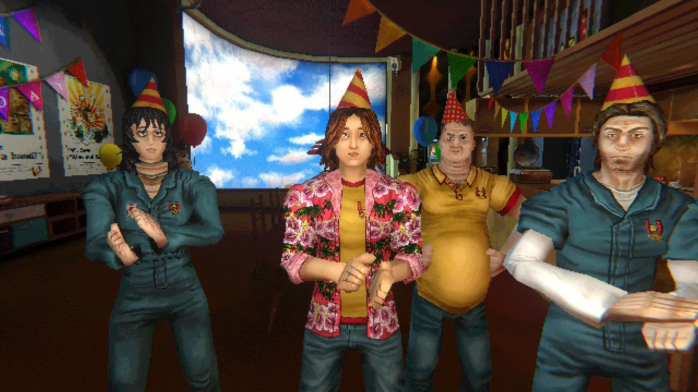

# Референс персонажей: конкретный кадр Mouthwashing

Зафиксировано 2026-10-28 по прямому запросу второго участника: «сохрани у себя в памяти, это будет референс к нашим моделькам». Картинка и её визуальный разбор — постоянный ориентир для следующих итераций персонажей Dark Alone; это не утверждение, что текущий TEST D уже соответствует цели.

Источник: предоставленный пользователем скриншот Mouthwashing, четыре персонажа в праздничных колпаках. Изображение сохранено без изменения для художественного обсуждения. Это внешний референс в документации, не игровой ресурс/текстура; разрешение на использование чужих моделей/изображений в игре не подразумевается.

## Общий вид

Стилизованные люди с простой объёмной геометрией и выразительными текстурами. Немного грубые лица, контрастные глаза, угловатые пряди волос и различимые телосложения. Формы связаны: плечи переходят в рукава, шея в голову, одежда облегает или скрывает фигуру.

Лица имеют художественную условность: подчёркнутые веки/брови, ясно читаемые носы/челюсти, матовая кожа и крупные участки света/тени. Волосы — объёмные группы прядей с внутренней фактурой и неровным контуром. Одежда строит силуэт шириной плеч, рукавами, талией, животом и раскрытыми полами; швы/складки/эмблемы/принты добавляют подробности.

Главное — согласованная степень условности лица, рук, волос и одежды. Характерные пропорции и поза читаются до мелкой фактуры. Увеличение детализации кожи или пикселизации само по себе не даёт этот стиль.

## Четыре фигуры слева направо

1. **Худощавая фигура в тёмном комбинезоне.** Узкие плечи/тонкие руки/обозначенная талия, объём ткани у плеч, локтей и бёдер. Светлое вытянутое лицо с суженной нижней частью, контрастные светлые глаза с тёмными тенями, тяжёлые веки, узкий нос и небольшой приоткрытый рот. Почти чёрные волосы до шеи, неровная чёлка, крупные острые пряди. Приглушённый сине-зелёный комбинезон с воротником, застёжкой, эмблемой, поясом/карманами; у шеи полосатый бежево-зелёно-красноватый слой. Руки сложены несимметрично перед корпусом; крупные угловатые кисти. Закрытая, немного напряжённая поза.

2. **Стройная фигура в яркой раскрытой рубашке.** Неширокие плечи, дополнительный объём по бокам от одежды. Лицо шире и мягче, наполненные щёки, небольшой подбородок, заметные светлые глаза с тёмными веками и слегка приоткрытый рот. Каштановые/рыжеватые волосы примерно до нижней части лица расходятся в стороны крупными прядями. Розовая рубашка с плотным пёстрым принтом, отложным воротником и подвёрнутыми рукавами; жёлтая футболка с красной отделкой. Тёмные сине-серые брюки с поясом/застёжкой. Кисти собраны перед животом, одна полусжата, другая опущена под углом; различимы суставы пальцев.

3. **Широкая тяжёлая фигура сзади в жёлтом поло.** Выступающий округлый живот, полные руки, короткая массивная шея. Широкое округлое лицо, полные щёки/тяжёлый подбородок, небольшие относительно лица глаза, широкий нос/компактный рот, складки у шеи. Короткие светлые волосы частично закрыты колпаком. Горчичное поло с тёмной окантовкой воротника, бордовыми краями рукавов, эмблемой и подвеской на шнурке. Натяжение ткани подчёркивает живот. Локти отведены в стороны, руки ближе к бокам/за корпусом, увеличивая ширину силуэта.

4. **Широкоплечая фигура справа.** Мощный плечевой пояс, толстая шея/предплечья, более прямое собранное туловище. Вытянутое лицо с тяжёлой челюстью/подбородком, выраженными надбровными дугами, переносицей и плоскостями щёк. Тёмные достаточно прямые брови, контрастные глаза, тёмная фактура щетины у рта/подбородка. Тёмные волосы зачёсаны назад крупными прядями. Сине-зелёная рабочая одежда с короткими рукавами/воротником/застёжкой/эмблемой, под ней белые длинные рукава с крупными заломами у локтей/запястий. Предплечья перед корпусом, кисти одна над другой; длинные пальцы/суставы/ногти читаются при упрощённой форме.

## Как применять к нашим моделям

- Сначала индивидуальный силуэт, пропорции головы/шеи/плеч/туловища и убедительная поза; затем детали. Не получать всех гостей перекрашиванием одного тела.
- Проверять связность плеч/рукавов/кистей, характерную форму челюсти и объём головы сбоку. Лицевая фотографическая маска на примитивном теле не соответствует референсу.
- Держать лицо/волосы/одежду/кисти на согласованном уровне стилизации: заметные плоскости, читаемые глаза/веки, крупные пряди, фактура ткани без случайного равномерного шума.
- Сверять результат у стойки в игровом свете и разрешении, а также спереди/сбоку. Отдельно смотреть силуэт без фактуры.
- Этот кадр задаёт художественный ориентир; конкретные лица, одежду, логотипы, имена и историю чужих персонажей не переносить в канон Dark Alone.

## Границы наблюдений

По изображению нельзя установить число полигонов, размеры текстур, устройство рига, какие именно складки выполнены геометрией, а какие текстурой, или качество анимации. Ноги показаны не полностью; рост нельзя уверенно сравнивать из-за перспективы. Пикселизация, зерно и цветные контуры могут относиться к обработке всего кадра, их нельзя автоматически приписывать моделям.
