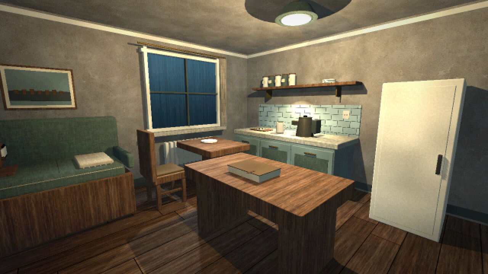
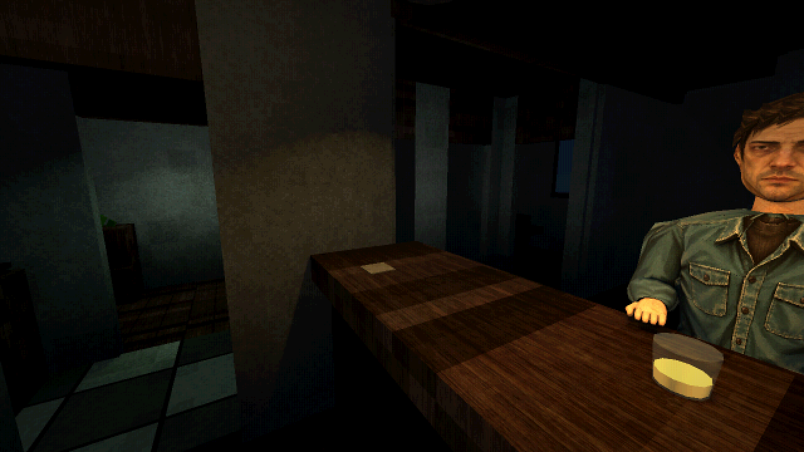

# TEX-01: дерево, штукатурка и обивка

2026-10-29. Первый игровой комплект по [TEXTURE_DIRECTION](TEXTURE_DIRECTION.md). Создан и применён в баре и доме; планировка, мебель, коллизии, взаимодействия и освещение не изменены.

## Ассеты и применение

| Файл в assets/textures/environment | Материал | Потребители | Размер поверхности на один проход изображения |
| --- | --- | --- | --- |
| walnut_v1.png | Приглушённый потёртый орех | Деревянные полы, стойка, столы, стулья, домашняя мебель | 0.75 × 1.5 м |
| plaster_v1.png | Мелкозернистая серая бежевая штукатурка | Основная штукатурка бара и дома | 2 × 2 м |
| upholstery_v1.png | Нейтральная ткань с мелким переплетением | Сиденья бара, домашняя ткань, лён и ковёр | 0.65 × 0.65 м |

Источник — встроенный imagegen, по одной новой генерации на материал, без входных изображений. Режим generate, фон непрозрачный. Название модели инструментом не раскрыто. PNG сохранены без перерисовки; фактический исходник каждого — 1254 × 1254, хотя запрос задавал 1024. Импорт в Godot: 512 × 512, lossless, mipmaps. Фактические размеры и mipmaps проверены загрузкой ресурсов. `.import` и `.uid` входят в исходники.

Новые карты — только albedo. Отдельные normal/roughness/AO не генерировались. Материалы сохраняют существующую процедурную отделку и микрорельеф дома; небольшая вариация шероховатости выводится из цвета. В баре прежний шейдер отключает specular, поэтому это не полный PBR-комплект. Плитка, стекло, металл, сантехника и персонаж остаются на прежних материалах.

## Подключение

`scripts/presentation/environment_textures.gd` назначает текстуру, размер проекции в метрах и художественный баланс каналов. `detail_average` — подобранная компенсация цвета в текущем Compatibility-рендерере, не измеренная средняя величина изображения. Оттенок помещения по-прежнему задаётся `tint` существующего материала.

Общий `assets/shaders/environment_texture.gdshaderinc` добавляет фактуру в `house_surface.gdshader` и `worn_surface.gdshader`. По умолчанию `detail_enabled=false`, старые потребители сохраняют поведение. Дом подключает фактуру в `HouseDressing._mat`; бар — в `ReferenceBar.material` и отдельно к основной штукатурке. Проекция зависит от локальных метров поверхности; крупное дерево направлено вдоль досок. Старый искусственный рисунок древесины дома приглушён при включённой карте.

Края исходных AI-карт не считаются гарантированно бесшовными. Шейдер использует отражённое повторение: соседние края совпадают, полный период равен двум ширинам/высотам. Это может давать симметричные мотивы на больших площадях. `textureGrad` получает производные до сворачивания координат; включена фильтрация linear/mipmap/anisotropic. При следующих итерациях проверять повторение и рябь в движении, особенно деревянный пол. Нейтральный albedo не содержит зелёного света из референса — цвет света задаёт сцена.

## Точные запросы генерации

### walnut_v1.png

> Create a production game texture, square 1024x1024, full frame seamless tileable ALBEDO ONLY of aged muted grey-brown walnut timber. Dark Alone psychological horror modern PS1 realistic material style. Orthographic flat surface, long fine irregular wood grain runs vertically, restrained diffuse natural brown and grey variation, old worn finish, subtle scratches, no board borders, no large distinctive knots, no furniture, no perspective, no text, no grid, no directional light, no shadows, no highlights, no green lighting, no vignette. Quiet detail balanced with broad calm areas. Opposite edges should tile seamlessly. This is a usable base color texture not a scene or material sphere.

### plaster_v1.png

> Production game seamless texture ALBEDO, square 1024x1024 full frame: old matte lime plaster painted muted warm grey beige, subtle uneven broad coloration with calm areas, very fine chalky mineral grain, faint old wear and tiny irregular abrasions, modest aging not abandoned ruin. Dark Alone atmospheric modern PS1 psychological horror realistic material. Flat orthographic evenly lit neutral diffuse surface, seamless opposite edges. No directional lighting, shadows, highlights, perspective, objects, borders, writing, large cracks, green tint, vignette or camera noise. Material must remain readable and quiet at distance.

### upholstery_v1.png

> Production game material texture square 1024x1024 full frame, seamless tileable ALBEDO of old upholstery fabric, desaturated neutral grey taupe linen with fine tight irregular woven threads. Gently worn and faded in broad subtle uneven patches, mostly calm consistent weave, minimal dirt, no seams or borders, no cushion or furniture, no perspective or draped folds, no writing. Neutral diffuse flat lighting, absolutely no directional shadows highlights vignette or screen noise. Photographic material foundation appropriate for gritty modern PS1 psychological horror, readable medium scale texture, restrained contrast, seamless opposite edges. Neutral color designed for tinting sage green or muted burgundy in game.

## Проверенный игровой вид

Снимки из Godot, с игровым светом и ретро-профилем. Проверки и дальнейший шаг — в [протоколе](worklog/2026-10-29-07-environment-textures.md).
