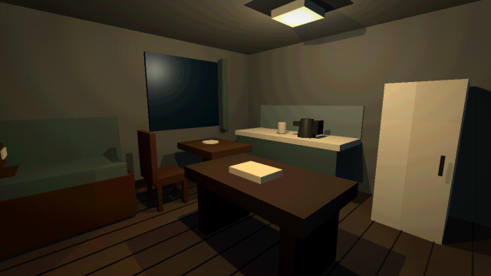
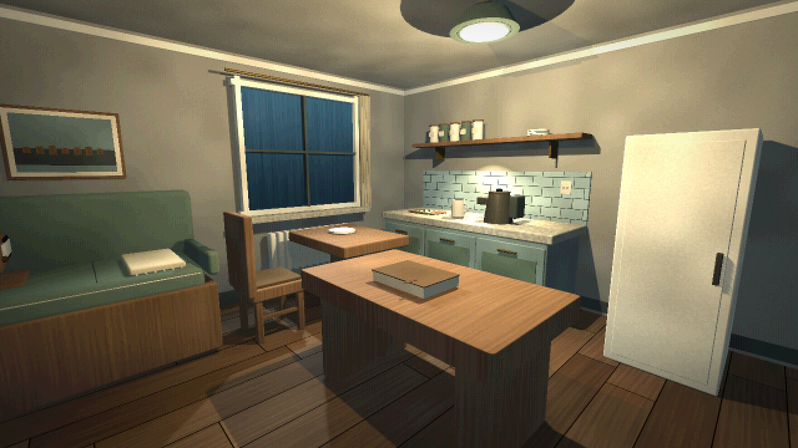
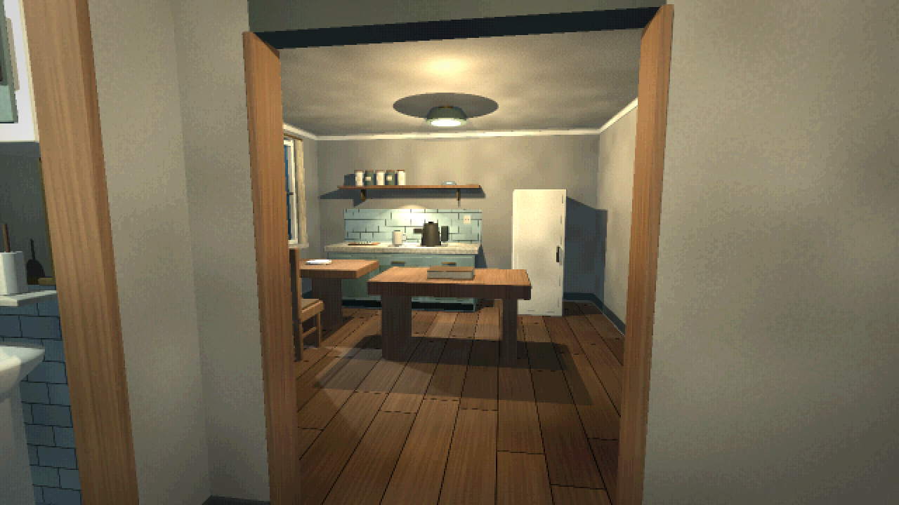
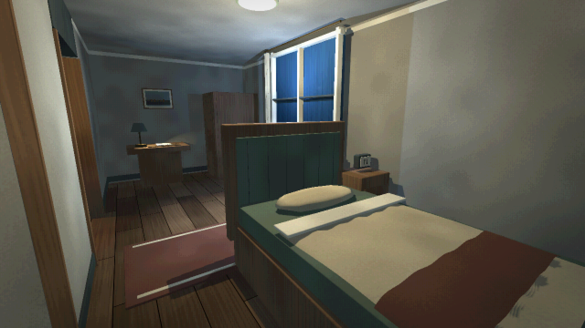
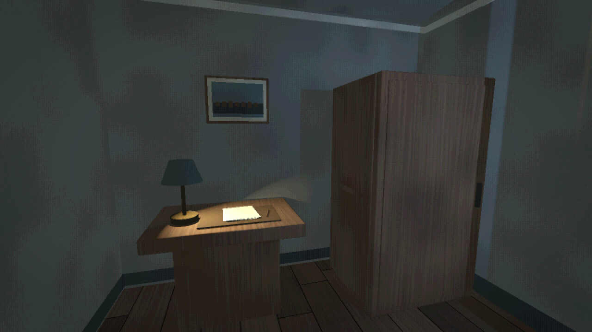
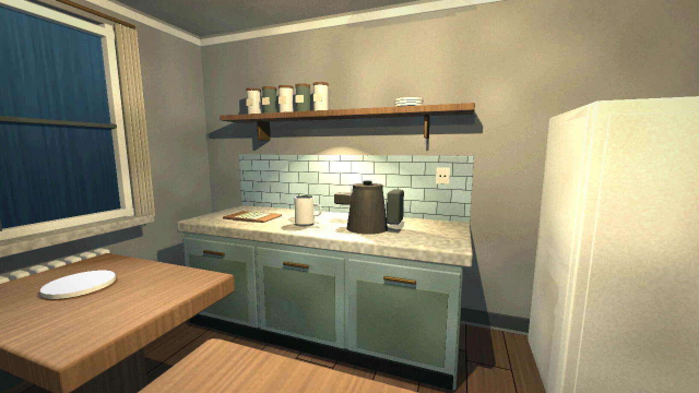
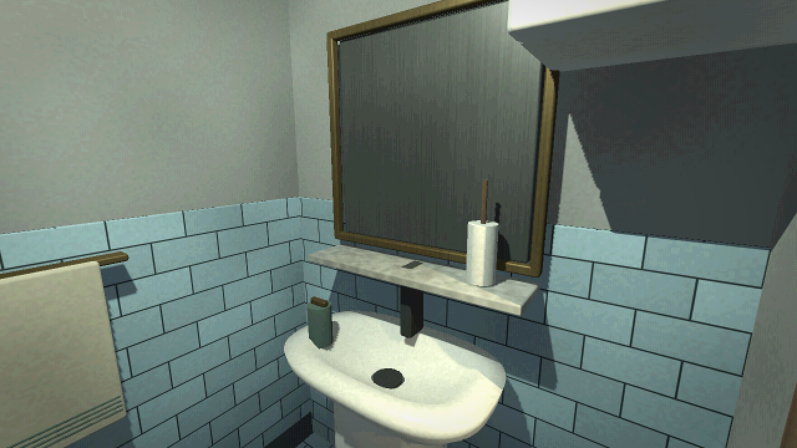

# HOME-03: оформление существующего дома

29 октября 2026. Основа — HOME-02 из `24d433d`, ветка `codex/house-visual-redesign`. Прямое условие участника: сохранить структуру и узнаваемость дома, расстановку, размеры, проёмы и бытовые действия. Более раннее разрешение подгонять мебель/проходы при замене моделей **не применяется к этой задаче**.

## Что сохранено

Четыре комнаты, пол 8,6 × 7,6 м, потолок 2,94 м, все стены/двери/окна, оба прохода в спальню и вход в санузел. Столы, диван, стул, кухня, холодильник, кровать, шкаф, сантехника остаются на исходных местах. Лестницы в исходном доме нет, новая не добавлена. Коллизии, точки осмотра/сидения, действия E, шторы/дверцы, чайник, вода, радио, выход на работу и сохранения прежние.

`tests/fixtures/house_layout_baseline.json` записан **до редизайна**. Он содержит 272 исходных меша, формы коллизий и якоря; контролирует положения, ориентацию, масштаб, AABB мешей, размеры коробочных коллизий и слои. Единственная динамическая капсула игрока исключена из снимка архитектуры. Числовые суффиксы автоматически созданных узлов нормализуются, float сравнивается с допустимой погрешностью движка. Это не новое описание желаемой планировки: это контроль фактического исходника.

## Художественное решение

Небольшое обжитое жильё с приглушённым дубом, тёплой матовой штукатуркой, серо-зелёными окрашенными фасадами, кремовой керамикой, льняным текстилем и тусклой латунью. Все комнаты используют одну библиотеку материалов. Дерево имеет волокна, пол — разную длину досок и тонкие швы, плитка — затирку и небольшую разницу оттенков; ткань — мелкое плетение. Рисунок и микрорельеф процедурные, без сторонних изображений/лицензий, остаются прикреплёнными к движущимся дверцам.

Тёплые потолочные светильники объединяют комнаты, кухня и письменный стол имеют локальные рабочие источники, от прежних окон идёт холодный ночной свет. Дом получает собственную Environment камеры; окружение бара не затрагивается. Общий ретро-фильтр и пользовательские настройки сохранены. Для более чёткого изображения можно выключить ретро-эффект в существующих настройках.

| Помещение | Переработка |
| --- | --- |
| Прихожая | Филёнки входной двери, ручка/замок, обрамление, плинтусы, крючки/детали куртки, ключи и фасад тумбы |
| Кухня-гостиная | Скруглённая мебель, рамочные фасады кухни, каменная столешница, плиточный фартук, полка с посудой/банками, чайник/кружка, доска и полотенце, детали радио, диванный кант/плед, книга и следы кружки |
| Спальня | Мягкая подушка, сетки одеяла и покрывала со складками, обитая вставка изголовья, ковёр, отделка шкафа/тумбы, часы, бумаги и настольная лампа |
| Санузел | Плиточная отделка, объёмная керамическая раковина, слив, чаша унитаза, рама/полка зеркала, полотенце, мыло и стакан |
| Все комнаты | Карнизы/плинтусы по прежним стенам, оконные рамы/подоконники, радиаторы и складчатые шторы |

Новые мелкие детали декоративные и без коллизий. У переоформленных раковины, лампы, унитаза и штор сохранены исходные невидимые поверхности взаимодействия, а визуальные детали находятся там же. Шторы следуют размеру/положению первоначальной интерактивной ткани; накладки дверей крепятся к их исходным узлам/петлям. Потолочные рассеиватели и дополнительный свет выключаются вместе с соответствующим старым выключателем.

## Виды из движка

Один и тот же ракурс кухни-гостиной до и после, стандартный ретро-профиль. Это снимки Godot, не концепт-арт и не изображения генератора.

До:

После:

## Проверить и продолжить

F5 → закончить смену → домой. Обойти все комнаты, сесть/встать, открыть шкаф/холодильник, сдвинуть обе двери и шторы, включить/выключить свет, чайник/радио/воду. Проверить, что декоративные элементы не закрывают прицел на предметах. Полный протокол — [worklog](worklog/2026-10-29-05-house-redesign.md).

Работа выполнена в Godot 4.7.2 Compatibility, без перехода на Unreal/Forward+ и новых зависимостей. Уровень UE5 из запроса — художественный ориентир, а не подтверждение фотореализма или наличия Lumen: здесь остаются стилизованные процедурные материалы, прямой свет и существующая постобработка. Зеркало по-прежнему не даёт настоящего отражения комнаты/героя. Архитектура и габариты исходных примитивов намеренно ограничивают силуэт мебели. Следующий художественный проход по отзывам участника может заменять отдельные предметы авторскими моделями **в тех же пределах**, без перепланировки.
