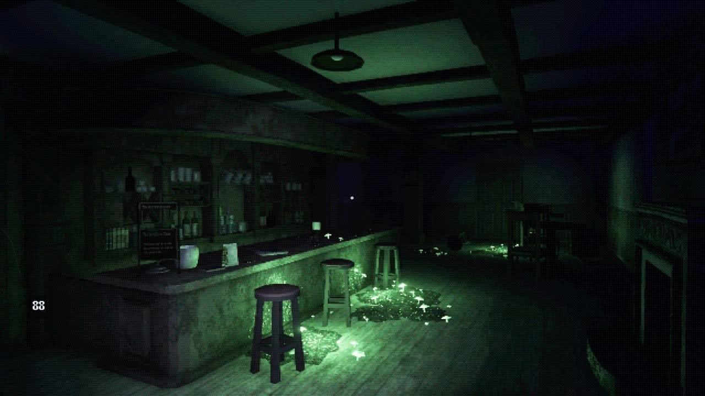

# Текстуры окружения: состаренная реалистичная основа и ретро-грубость

2026-10-29. Участник одобрил направление по предоставленному кадру бара и попросил подробное описание, затем сохранить его в Git. Это руководство для следующих художественных проходов; оно не означает, что все описанные поверхности уже реализованы. Последнее обсуждение не поручает менять игру.

Источник — изображение участника. Игра, автор, разрешение исходных текстур и устройство материалов по одному кадру не установлены. Кадр хранится как документальный ориентир; не использовать его части как игровые текстуры. Числа ниже — предложения для Dark Alone, не измерения референса.

## Общий характер

Материалы узнаваемы как настоящее дерево, штукатурка, ткань, металл и стекло. Их характер передаётся крупными деталями и сдержанной мелкой фактурой. Поверхности старые, матовые, неоднородные: затёртая древесина, выцветшая краска, потемнение стыков. Износ связан с использованием: выступы и места касания отличаются от углублений, возле пола и соединений больше загрязнения.

Изображение немного грубое, зернистое, отдельные мелкие детали сливаются. На расстоянии остаются видны материал, направление волокон, швы и крупные пятна. Не заполнять каждую поверхность одинаковым контрастным шумом: спокойные участки нужны для читаемости.

## Палитра

- Древесина: серо-коричневая, выцветший орех, близкие тёплые и холодные оттенки досок.
- Стены: грязноватый бежевый, серый, оливковый; широкая слабая неоднородность окраски.
- Металл: угольный, тёмно-серый, приглушённая латунь.
- Обивка: тусклый бордовый, коричневый, серо-зелёный.
- Бумага/керамика: пыльный кремовый, сероватый белый.

Сильный зелёный оттенок кадра во многом относится к освещению. Не запекать его во все albedo: нейтральный материал должен работать под тёплой лампой и холодным ночным светом. Бар и дом используют согласованную библиотеку поверхностей, с разными светом и настроением.

## Деревянный пол

Вытянутые доски с неровными продольными волокнами, которые местами стираются и теряются. Между досками — небольшая разница тона и узкие тёмные стыки. Добавлять отдельные продольные царапины, локальные мягкие пятна, потёртость основных маршрутов, потемнение возле стен и под мебелью.

Рельеф неглубокий: пол не должен выглядеть корой или резьбой. Старая отделка частично сохраняется и различимо реагирует на свет. Нужны варианты досок/раскладки, чтобы один сучок или пятно не повторялись через равные промежутки.

## Стойка и деревянная мебель

Стойка массивная, боковые панели потемневшие, края затёртые. Верх отличается от фасада степенью использования. Для столешницы: широкие спокойные волокна, следы протирания, неглубокие царапины, немного слабых колец от стаканов, пятна с мягкими неровными границами и остатки покрытия. Боковые панели суше и грязнее внизу/в соединениях; стёртые кромки немного светлее.

Столы, полки и стулья сочетаются по породе/палитре дерева, но имеют разную степень износа. Не наносить одинаковые пятна на каждую модель.

## Штукатурка, потолок и балки

У стен три масштаба: крупные слабые пятна старения, небольшие различия окраски, мелкая шероховатость. Загрязнение локализовано возле пола, углов и примыканий предметов. Трещины и сколы редкие, характерные; не равномерная сетка повреждений. Основная поверхность матовая, с большими спокойными участками.

Потолок менее контрастный и подробный, чем область на уровне глаз. Достаточны мягкая неоднородность, потемнение соединений и слабое старение. Балки тёмные, с крупным направленным рисунком древесины; форма/стыки различимы при слабом свете. Мелкие яркие царапины на потолке не должны отвлекать от разговора.

## Стулья и обивка

Деревянные детали: стёртые края, царапины возле ножек, потемнение соединений и следы там, где стул берут рукой/задевают обувью.

Ткань: тусклый выцветший тон, плетение преимущественно вблизи, широкие зоны выцветания, потемнение швов, небольшая неоднородность и редкие пятна. Искусственная кожа: мягкие складки, затёртый центр, слабые трещинки на сгибах, небольшой блеск мест касания. Издали обивка воспринимается цельным материалом без ряби контрастного узора.

## Металл

Потускневший металл с локальными царапинами, окислением и светлыми выступами. Окрашенный металл преимущественно матовый, со сколами краёв; латунь коричневатая, светлее в местах касания; сталь холодная, с узкими бликами и следами протирания; крепёж темнее окружающей поверхности.

Ржавчина только там, где есть причина: влажный пол, соединение трубы, повреждение краски. Одинаковая ржавчина на всей мебели выглядит искусственно.

## Стекло, бутылки, керамика и бумага

Стекло читается силуэтом, отражениями и небольшими светлыми участками. Бутылки тёмно-зелёные, коричневые и почти бесцветные, с разной прозрачностью. Разводы, пыль на плечиках и отпечатки у горлышка заметны только в подходящем свете.

Керамика кремовая/сероватая, с мягким блеском, небольшими различиями глазури, потемнением основания и единичными сколами. Этикетки и бумага выцветшие, с потемневшими краями. Значимые игровые надписи остаются читаемыми.

## Разрешение и согласованность

| Применение | Предварительный ориентир |
| --- | --- |
| Небольшой предмет, простая этикетка | 128–256 px |
| Стул, дверца, небольшая мебель | 256–512 px |
| Повторяемое дерево, штукатурка, плитка | 512 px |
| Крупный предмет для близкого осмотра | 512–1024 px |

Размер выбирается по площади поверхности и расстоянию до игрока. Соседние предметы должны иметь сопоставимую плотность детализации. Мипмапы/фильтрацию проверять в движении, чтобы удалённые мелкие детали не мерцали. Умеренная пикселизация сохраняет читаемость фактуры; сильный экранный шум может скрыть её.

## Реакция на свет и микрорельеф

Штукатурка рассеивает свет; старая древесина даёт слабый широкий блик, остатки лака отражают сильнее. Ткань почти не блестит; керамика имеет мягкие светлые блики, металл и стекло — более выраженные отражения. Разницу материалов создаёт также неоднородная шероховатость, не только цвет.

Микрорельеф сдержанный: волокна, затирка и зерно штукатурки помогают свету раскрыть поверхность. Слишком сильные normal/bump делают материалы похожими на грубый пластик. Постоянное направленное освещение/зелёный тон не запекать в базовый цвет.

## Правило применения и приёмка

Каждая поверхность содержит основу материала, крупные особенности и локальные следы использования. У стола это волокна, разница оттенков досок и несколько следов посуды. Проверять при нейтральном свете, затем в игровом освещении, с ретро-фильтром и без него, вблизи и при ходьбе.

В баре стойка, лицо NPC, проходы и интерактивные предметы должны быть светлее и понятнее, чем самые тёмные участки референса. Дом использует более мягкий свет и спокойные цвета. Декоративный износ не создаёт новых сюжетных улик и не меняет зафиксированную планировку HOME-03. Реализованный редизайн описан отдельно в [HOUSE_REDESIGN](HOUSE_REDESIGN.md).
